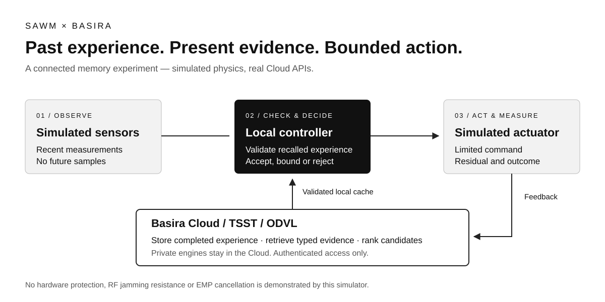
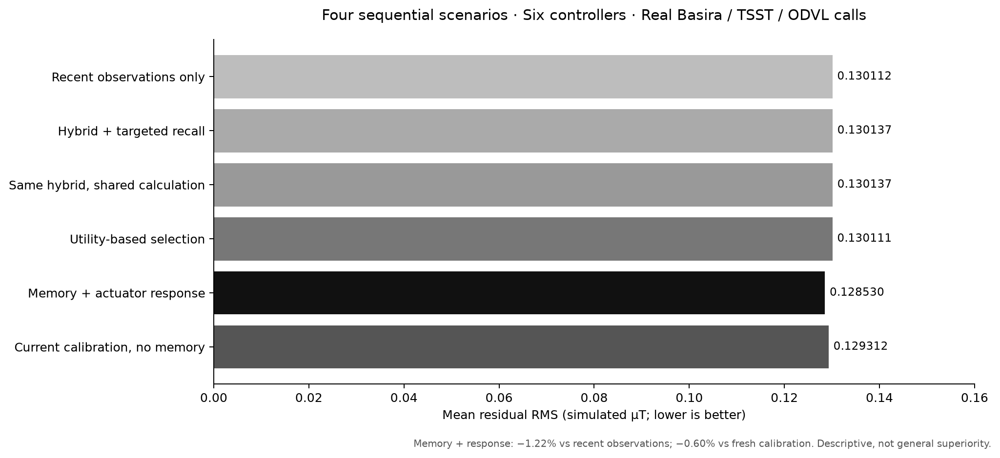

<p align="center"></p>

# Agentic Electromagnetic Defense

[](https://github.com/SAWM-io/agentic-electromagnetic-defense/actions/workflows/tests.yml)

**SAWM × Basira — remember what worked, check what changed, and adapt the next action.**

A research demonstrator connecting a **bounded magnetic-control simulation** to the real **Basira, TSST and ODVL Cloud APIs**. The question is practical: can an experience retrieved from memory improve a decision now, without trusting an obsolete calibration?

The recorded experiment demonstrates that connection. It does **not** demonstrate an EMP shield, radio anti-jamming, a physical protective suit, or satellite qualification. The physics is simulated; the Cloud memory calls are real. The SAWM language model is not invoked in this benchmark.



## Start with the evidence

The latest recorded experiment used **four sequential situations, six comparison methods and 34 real Cloud calls**.

| What was checked | Measured result |
| --- | --- |
| Retrieve the latest experience for the equipment | **4 / 4 situations** |
| A recalled response calibration actually changes the command | **2 / 4 situations** |
| Reject an old calibration after the equipment changes | **Both changed-equipment situations** |
| Mean residual error versus recent measurements without episodic memory | **1.22% lower** |
| Mean residual error versus fresh calibration without memory | **0.60% lower** |
| Independent checks of the original experiment | **44 / 44 passed** |

These are modest descriptive gains on a small, dependent sequence, **not a general superiority claim**. After the unannounced change, the new calibration remained uncertain: the system rejected the obsolete one, but did not yet learn a reliable replacement. A separate ablation would be needed to isolate ODVL's contribution to these four cases.



- [Results, comparison methods and limitations](docs/results.md)
- [Public numerical evidence](evidence/)
- [English Medium article](docs/articles/AGENTIC-ELECTROMAGNETIC-DEFENSE-MEDIUM.md)
- [Research roadmap and potential applications](docs/roadmap.md)

The original laboratory suite passed 255 software tests. That count belongs to the original experiment; this repository has **166 passing tests** and its own CI. The packaged example starts a new history and does not claim to reproduce the private laboratory's 44 prior experiences. [Publication validation and exact test scope](docs/VALIDATION.md).

## How the loop works

1. **Observe.** Read the current simulated sensor history. Future measurements and hidden simulator parameters are unavailable to the controller.
2. **Retrieve.** Basira stores completed experiences. Typed TSST filters select the equipment and known experience identity, rather than relying on an identifier buried in a text search.
3. **Compare.** ODVL supplies memory state for candidate ordering. The controller checks provenance, chronology, uncertainty and compatibility with current measurements.
4. **Act.** Apply a bounded correction only when the checks pass. Otherwise keep the baseline controller. Local command and slew limits still apply.
5. **Learn from the outcome.** Store the completed observation, estimated response and measured result. At the next interaction, retrieve that experience and check it again.

“Prediction” here means extrapolating from already observed measurements. The recorded forecast horizon is **32 simulated milliseconds**; it is not a Cloud response-time guarantee. Reading a validated local cache can be fast without making a remote service a hard real-time controller.

## Run the program

Use Python 3.12 or newer. Run from the repository root:

```sh
git clone https://github.com/SAWM-io/agentic-electromagnetic-defense.git
cd agentic-electromagnetic-defense
python3 -m venv .venv
source .venv/bin/activate
python -m pip install -r requirements.txt
python -m pytest -q
python scripts/verify_evidence.py
python run_demo.py --mode offline --output runs/offline-demo
```

**Offline means no Cloud.** It exercises the numerical baseline and must not be presented as a Basira/TSST/ODVL execution.

### Connect your own Cloud laboratory

Create an authorized laboratory environment and a dedicated entity through the [Basira console](https://basira.sawm.io/espace). Use a key whose scopes and grants permit the entity's assertion writes, TSST reads and ODVL operations. Keep this experiment separate from customer or production memories.

```sh
mkdir -p "$HOME/.config/sawm-em-lab"
cp .env.example "$HOME/.config/sawm-em-lab/cloud.env"
chmod 600 "$HOME/.config/sawm-em-lab/cloud.env"
# Edit cloud.env locally: replace every placeholder with your own lab values.

python run_demo.py --mode cloud \
  --credentials "$HOME/.config/sawm-em-lab/cloud.env" \
  --confirm-dedicated-lab \
  --output runs/cloud-demo
```

Cloud use requires your own enabled account, quota and access rights and may consume paid credits. The client does not provision elevated access. Use a new output directory for each run; do not blindly replay interrupted writes. If an operation is rejected or cannot be verified, keep its evidence and investigate rather than replacing it with a simulated Cloud response.

Runtime receipts may identify your environment. Generated runs are ignored by Git; review them before sharing. The examples contain placeholders only.

## What a customer could build next

| Application | Potential value | What still needs validation |
| --- | --- | --- |
| Robotics and precision instrumentation | Remember equipment-specific disturbances and calibration history; reduce repeated setup work | Real sensors, actuator characterization, multi-axis tests and local latency bounds |
| Industrial environments | Distinguish a recurring disturbance from changed equipment; retain a traceable maintenance history | Held-out sites, calibrated measurements, false-action rates and EMC testing |
| Protective equipment and wearable electronics | Help monitor sensor health and select tested operating modes | Safe hardware, thermal/power limits and independent protection; no shield is demonstrated |
| Satellites and scientific payloads | Preserve magnetic-cleanliness history and correlate disturbances with operating modes | Mission-specific hardware, space qualification and autonomous offline operation |

Memory can support a tested protection system. It cannot restore damaged electronics or substitute for shielding, filtering, grounding and other appropriate hardware measures. These applications are a **research direction**, not current product certifications.

## Improvements to measure next

- Learn a reliable replacement calibration after drift, rather than only rejecting an old one.
- Test longer histories, more equipment, unseen conditions and repeated independent seeds.
- Compare each memory component separately against strong memory-free controllers.
- Make present-time relevance and uncertainty part of selection, rather than using recency alone.
- Measure end-to-end latency and cache invalidation under interruption and service unavailability.
- Move from a one-axis lumped simulation to a calibrated low-energy hardware bench, then spatial and multi-axis validation.

The [roadmap](docs/roadmap.md) states the evidence needed for each stage.

## Public client, private technology

This repository contains the client, local numerical experiment and publication copies of evidence. **The source of SAWM, Basira, TSST and ODVL engines is not included.** The vendored SDK is an HTTP client, not a memory-engine implementation.

See [the publication boundary](PUBLICATION.md) and [security guidance](SECURITY.md). Public visibility does not grant Cloud access or a license to the private engines. For pilots and commercial integration, contact SAWM through [basira.sawm.io](https://basira.sawm.io/).
