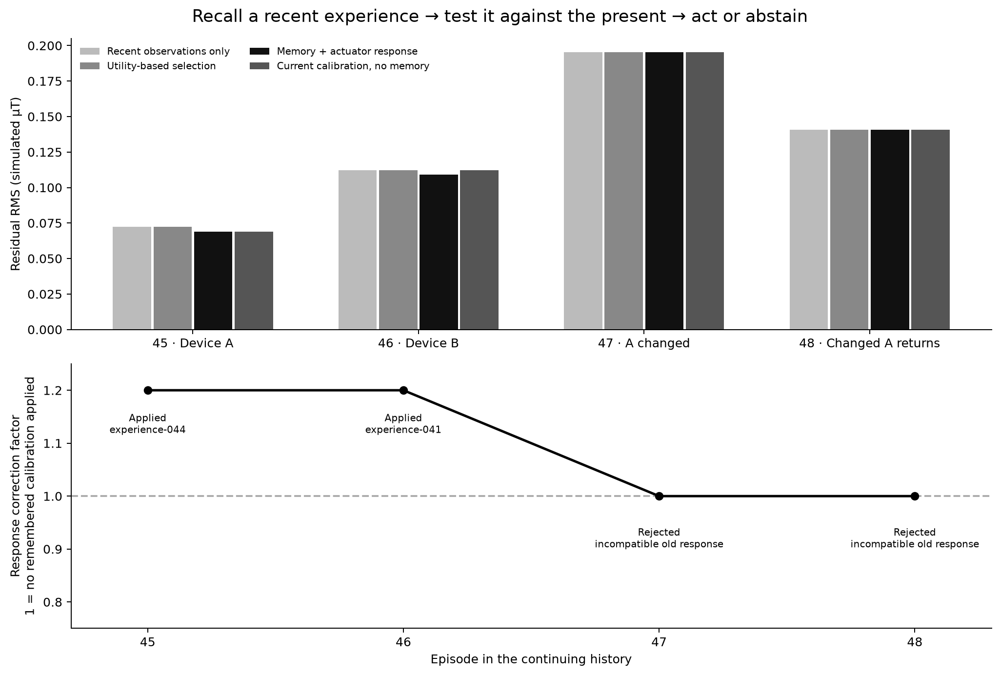

# Measured results and public evidence

**Study completed 29 October 2026.** Four sequential simulated situations, six controller variants, and **34 real Basira / TSST / ODVL Cloud calls**. The physical signals and actuator are simulated. The SAWM language model was not invoked or trained.

The important result is a verified chain: a recent experience is returned by the actual Cloud API, checked against current observations, and allowed to change the command only when the check passes. This is an integration and control experiment, not demonstrated electromagnetic protection of hardware.

## Every comparator

Lower RMS means less residual magnetic disturbance in the model. A negative percentage is a reduction in error, **not a success rate**.

| Controller | Mean residual RMS (simulated µT) | Change vs observations only | 32 ms forecast RMS error (simulated µT) |
| --- | ---: | ---: | ---: |
| Recent observations only | 0.130111571 | +0.00000% | 0.016978627 |
| Hybrid + targeted recall | 0.130137202 | +0.01970% | 0.017586832 |
| Same hybrid, shared calculation | 0.130137202 | +0.01970% | 0.017586832 |
| Utility-based selection | 0.130111270 | -0.00023% | 0.016670076 |
| Memory + actuator response | 0.128530291 | -1.21533% | 0.016670076 |
| Current calibration, no memory | 0.129312084 | -0.61446% | 0.016978627 |


The memory + response version reduces mean residual error by **1.22%** against recent observations only, and **0.60%** against a separate calibration using only current observations. These are small descriptive differences across four dependent episodes. They do not establish general superiority, statistical significance, or the isolated contribution of ODVL.

The 32 ms forecast concerns the measured disturbance reference. It is computed from already observed samples; later samples are used only to score it. Correcting actuator response changes the command, not this forecast. A 32 ms simulated prediction horizon is not a measured Cloud or hardware control deadline.

## What happened in each situation

| Display episode | Memory + response RMS (simulated µT) | Change vs observations only | Remembered response correction |
| --- | ---: | ---: | --- |
| 45 | 0.069086083 | -4.42414% | Applied |
| 46 | 0.109125279 | -2.78479% | Applied |
| 47 | 0.195253691 | +0.00453% | Rejected |
| 48 | 0.140656110 | -0.00715% | Rejected |



- **45 / Device A:** the latest accepted response experience passes the current-measurement check. A bounded correction changes the command. The current-calibration baseline also achieves the same result here, so this gain is not exclusive to memory.
- **46 / Device B:** a previously validated calibration remains consistent with current measurements and is applied. A fresh calibration from the short current prefix remains too uncertain, illustrating one possible use of historical experience.
- **47 / Changed device A:** the recent experience is retrieved, but its old calibration contradicts present measurements and is rejected. This case is very slightly worse than the observations-only reference; it is retained in the table.
- **48 / Changed A returns:** the immediately preceding experience is retrieved. Its new calibration is still uncertain, and the older incompatible calibration is again rejected. Successful re-learning of the changed equipment has **not** been demonstrated.

Display episodes45–48 correspond to zero-based indices44–47 in the numerical files. `experience-NNN` labels are publication aliases, not usable Cloud identifiers.

## What Basira, TSST and ODVL each do

- **Basira Cloud:** records completed synthetic observations with provenance and versions. The newest version of each device was read again through a fresh connection.
- **TSST:** returns candidates using explicit identity/provenance constraints. A previous text-only query could omit newly written experiences despite successful storage; typed recall corrected that selection issue.
- **ODVL:** supplies the memory states used to order frequency candidates. Response calibration prioritizes recency, with ODVL only breaking ties. Unique episode indices mean this experiment does not isolate a causal ODVL benefit.
- **Local controller:** qualifies candidates using observations already available, computes a bounded command, and measures its simulated result. It is a numerical policy, not an LLM reasoning process.

The latest experience for the relevant device was returned in **4/4 cases**. Remembered response corrections were effective in **2/4 cases**. There were **1,200/1,200 successful cache reads**, with an HTTP request independently observed in flight during each of four measurement batches. These are local cache timings, not intrinsic server response times.

## Evidence and independent checks

The original private-evidence audit passed **44/44 checks**, including accepted Cloud receipts, matching revisions, causal decisions, replayed controller traces, and unchanged source hashes. The study recorded **34 accepted calls** and no rejected call. This repository preserves a **sanitized publication copy**, not the original authenticated receipt journal.

Run the public numerical verifier:

```sh
python scripts/verify_evidence.py
```

It verifies file hashes and recalculates metrics for **24 controller runs**, reconstructs **168 forecasts from past samples**, compares command effects, checks common prefixes and actuator bounds, and preserves all six comparators. It requires no credentials or private engines. **It cannot authenticate omitted Cloud receipts or recreate the inherited44-episode memory.**

Published artifacts:

- [Numerical summary](../evidence/current-decision/summary.json)
- [Every episode and outcome](../evidence/current-decision/episodes.json)
- [Decisions and reasons](../evidence/current-decision/decisions.json)
- [Memory-to-command trace](../evidence/current-decision/memory-flow.json)
- [Sanitized protocol and simulated schedule](../evidence/current-decision/protocol.json)
- [Reported original audit](../evidence/current-decision/audit-summary.json)
- [Publication provenance and original hashes](../evidence/current-decision/provenance.json)
- [Synthetic numerical traces](../evidence/current-decision/traces.npz)
- [Published-file checksums](../evidence/current-decision/manifest.json)

The fresh runnable demo in this repository is a separate experiment with new episode identities. Its results need not equal these figures. Never publish a populated credential file or use the publication aliases to query the original laboratory account.

## Scope and next improvements

The model has one magnetic axis and one idealized point of protection, a low-amplitude disturbance, a first-order actuator, delay, noise, saturation and slew limits. It is not a Maxwell solver, a radio-jamming test, a shielding test, a radiation test, or an EMP-damage model. It does not demonstrate protection of robots, armor, spacecraft, people, or electronics.

The next useful experiments are larger held-out sequences, better identification after drift, calibration uncertainty checked against held-out outcomes, controlled ablations of each memory component, and low-energy hardware-in-the-loop validation. Sensor placement, geometry, bandwidth, actuator energy and failure behavior would then need explicit measurement. Broader protective applications remain a research direction.
